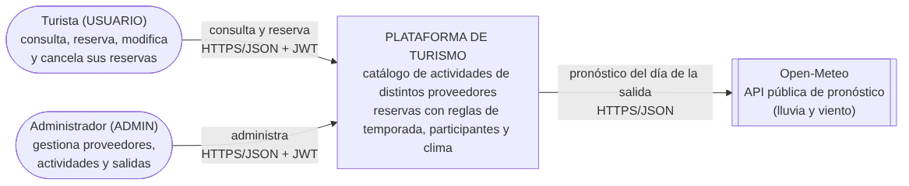
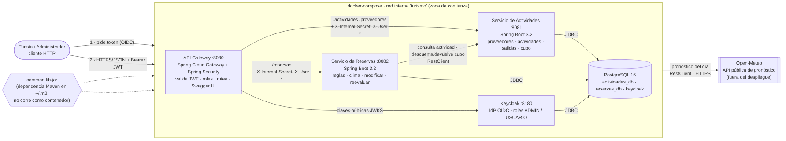

# TPI Backend de Aplicaciones 2026 — Dominio 5: actividades turísticas y excursiones

Plataforma que administra actividades ofrecidas por distintos proveedores. Cada actividad se ofrece en **salidas** (fecha + cupo) y una reserva depende de la temporada, las características de los participantes y el **clima** (API pública Open-Meteo): una reserva válida puede quedar pendiente, pasar a reprogramar o cancelarse.

## Arquitectura



| Componente | Responsabilidad |
|---|---|
| `api-gateway` | Único punto de entrada (:8080). Ruteo, Security Filter (JWT/roles), bloquea endpoints internos, Swagger UI |
| `actividadSpring` | Proveedores, actividades, salidas y cupo por fecha |
| `ReservaSpring` | Reservas, reglas de dominio, clima, modificar/cancelar/reevaluar (tarea programada) |
| `common-lib` | JAR Maven reutilizable: errores, `Identidad`, `Nivel`, filtro de zona de confianza |
| Keycloak | IdP (OIDC), roles `ADMIN` y `USUARIO` |
| PostgreSQL | Una instancia, **una base por servicio** (`actividades_db`, `reservas_db`) más la de Keycloak |

## Ejecutar todo con Docker
```
docker compose up --build
```
- Gateway y Swagger UI: http://localhost:8080/swagger-ui.html
- Keycloak: http://localhost:8180 (admin/admin). Realm `turismo`, usuarios `admin/admin` (ADMIN), `ana/ana` y `pedro/pedro` (USUARIO)
- Solo se publican el gateway y Keycloak; servicios y base quedan en la red interna.

Token y primera llamada:
```
TOKEN=$(curl -s -d client_id=turismo-client -d username=ana -d password=ana -d grant_type=password \
  http://localhost:8180/realms/turismo/protocol/openid-connect/token | jq -r .access_token)
curl -H "Authorization: Bearer $TOKEN" http://localhost:8080/reservas
```

## Ejecutar sin Docker (desarrollo)
```
docker compose -f docker-compose.keycloak.yml up -d     # solo Keycloak
cd common-lib && mvn clean install                       # JAR común a ~/.m2
cd ../actividadSpring && mvn spring-boot:run             # :8081 (H2 en memoria)
cd ../ReservaSpring && mvn spring-boot:run               # :8082 (H2 en memoria)
cd ../api-gateway && mvn spring-boot:run                 # :8080
```
Tests: `mvn test` en `ReservaSpring` y `api-gateway`.

## Documentación para la defensa
Ver [`DEFENSA.md`](DEFENSA.md): decisiones, justificaciones y preguntas probables, paso a paso.
